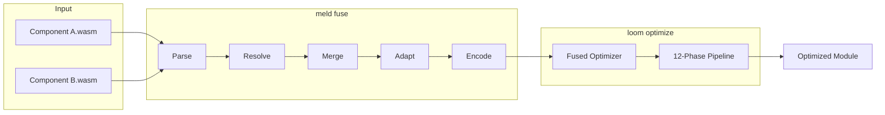
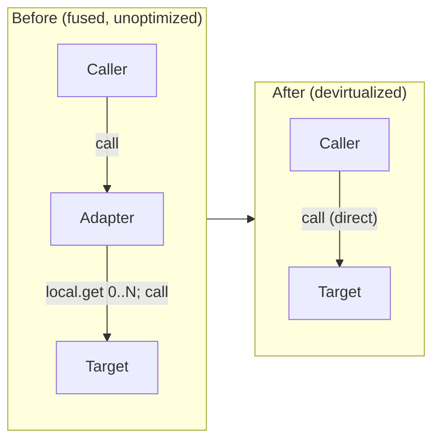
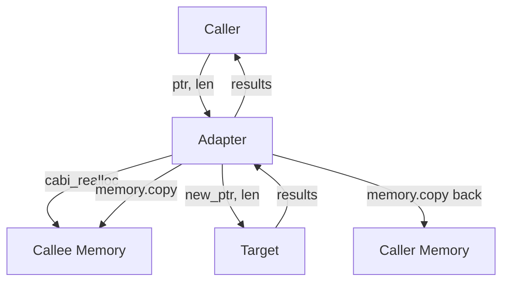
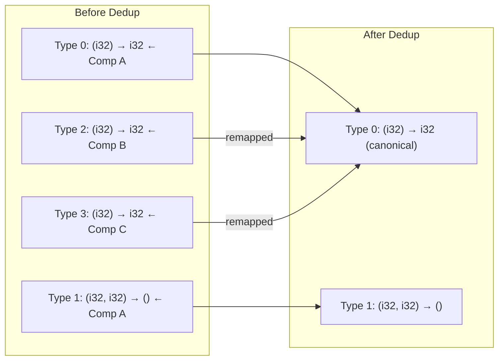
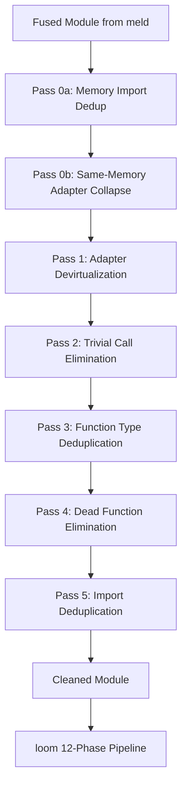
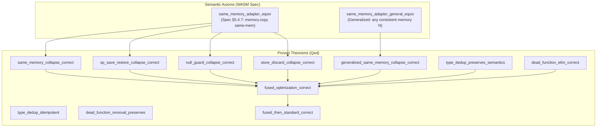
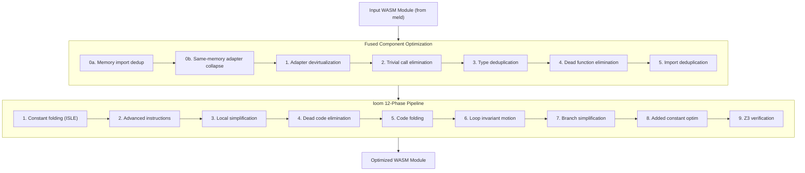
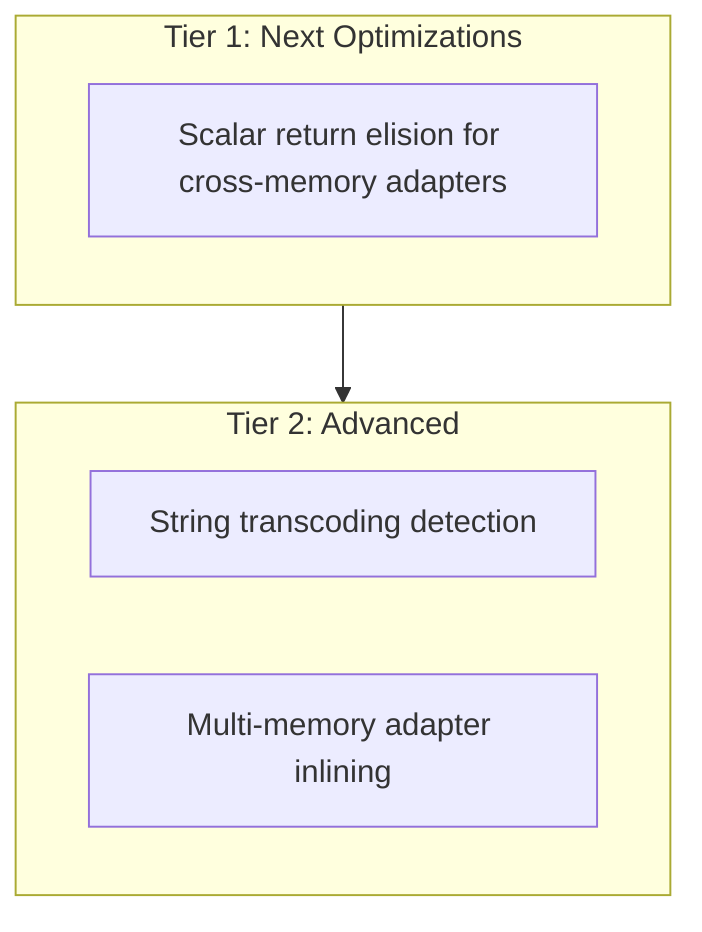

# Fused Component Optimization

Specialized optimization for WebAssembly modules produced by component fusion (e.g., meld).

## Overview

When multiple P2/P3 WebAssembly components are **fused** into a single core module, the result contains characteristic patterns that standard optimization passes miss. The fused component optimizer targets these patterns specifically, achieving additional size and performance improvements beyond what loom's standard 12-phase pipeline provides.

Component fusion (performed by tools like meld) combines multiple components into one module. This process introduces:
- **Same-memory adapters** that redundantly allocate+copy within a single linear memory
- **Adapter trampolines** for cross-component calls
- **Duplicate function types** from each source component
- **Duplicate imports** where multiple components imported the same external function
- **Dead functions** (adapters that can be bypassed)

The fused optimizer detects and eliminates these artifacts.

---

## The meld-loom Pipeline



**meld** handles the structural transformation: resolving dependencies, merging index spaces, generating adapter trampolines, and producing a valid single-module output.

**loom** handles the semantic optimization: devirtualizing adapters, eliminating dead code, folding constants, reducing strength, and verifying correctness.

Together they enable **whole-program optimization across former component boundaries** - something neither tool can achieve alone.

---

## Fusion Artifacts

### Adapter Trampolines

When component A calls a function exported by component B, meld generates an **adapter trampoline**:



For **direct adapters** (shared memory), the adapter is a trivial forwarding function:

```wasm
;; Generated by meld: adapter from component 0 to component 1
(func $adapter (param i32) (result i32)
  local.get 0        ;; Forward parameter
  call $target_func  ;; Call the actual target
)
```

For **memory-crossing adapters** (multi-memory mode), the adapter is more complex:



### Duplicate Function Types

Each source component contributes its own type section. After fusion, the merged type section contains duplicates:



### Duplicate Imports

Multiple components may import the same external function. These are merged and all references remapped.

---

## Optimization Passes



### Pass 0a: Memory Import Deduplication

**What**: Merge identical memory imports and remap all memory references to index 0.

**When**: Meld fuses components that share the same host memory, producing a module with multiple memory imports that all reference the same underlying linear memory (identical `(module, name)` pair). Per WASM spec §2.5.10, the same import key resolves to the same binding.

**Transformation**: Remove duplicate memory imports, remap all memory-indexed instructions (`memory.copy`, `memory.size`, `memory.grow`, `memory.fill`, `memory.init`), data segment memory indices, and memory exports to index 0.

**Safety (all-or-nothing)**: This pass only fires when ALL memory imports are identical and there are no local memories. Partial dedup could leave references to removed memory indices, so all-or-nothing is the only safe strategy.

**Synergy with Pass 0b**: After dedup, a previously multi-memory module becomes single-memory, enabling Pass 0b (same-memory adapter collapse) to fire on adapters that were previously skipped.

### Pass 0b: Same-Memory Adapter Collapse

**What**: Collapse same-memory adapters (realloc + memory.copy within one linear memory) into trivial forwarding trampolines.

**Pattern detected**: Functions where all memory operations target a single consistent memory index:
- Have locals (temporary pointers for the copy)
- Contain `memory.copy {N, N}` (same-memory copy, any consistent index N) with no cross-memory copies
- All load/store instructions target the same memory index N
- Call `cabi_realloc` at least once
- Call exactly one non-realloc target function
- Have no unsafe control flow (null-guard `If` blocks with empty/nop else bodies and safe-to-discard then bodies are allowed; `Block`, `Loop`, `Br`, `BrIf`, `BrTable` are rejected; balanced single-global save/restore is allowed; memory stores are allowed — they target the discarded realloc'd buffer)
- Have the same signature as the target

**Transformation**: Replace the function body with a forwarding trampoline:
```wasm
;; Before: allocate + copy + call target
(func $adapter (param i32 i32) (result i32)
  ... cabi_realloc ... memory.copy 0 0 ... call $target ...)

;; After: trivial forwarding (Pass 1 then devirtualizes)
(func $adapter (param i32 i32) (result i32)
  local.get 0
  local.get 1
  call $target)
```

**Why this is correct**: When all memory operations target the same linear memory (index N), `memory.copy {N, N}` copies within a single address space. The adapter allocates a buffer, copies argument data to it, then calls the target with the new pointer. Since both pointers reference the same memory, the target can read the data at the original pointer directly. The allocation and copy are semantically redundant. This holds for any memory index N, not just 0 — the key invariant is consistency within the adapter.

**Stack pointer save/restore**: Meld-generated adapters for non-trivial types often include a stack pointer prologue/epilogue (`global.get $sp; sub; global.set $sp` ... `global.set $sp` to restore). These balanced single-global writes are safe to collapse because the entire body is replaced by a forwarding trampoline — the global is never modified in the collapsed function (net-zero effect). The predicate `has_unsafe_global_writes` allows this pattern while still rejecting writes to multiple globals or write-only globals.

**Memory stores**: Meld-generated adapters for complex types (records, lists) perform field-by-field copying via load+store pairs alongside `memory.copy`. These stores target the freshly realloc'd buffer, which is discarded when the adapter body is replaced by a forwarding trampoline. The target reads from the original pointer in the same address space, so the stores are semantically redundant.

**Null-guard If blocks**: Meld-generated adapters for optional/nullable types wrap the realloc+copy in a null-guard `if` block. These are safe to collapse because: if the condition is true (Some), the copy is same-memory redundant — skipping it is equivalent; if false (None), the copy never ran anyway. The then_body must contain only safe-to-discard instructions (locals, constants, arithmetic, loads, stores, realloc calls, `memory.copy {0, 0}`). Nested `If` inside `If`, non-empty else bodies, `Block`, `Loop`, `Br`, `BrIf`, and `BrTable` remain rejected.

**Cross-memory adapters**: Adapters where memory operations target different indices (e.g., `memory.copy {0, 1}` or loads from memory 0 mixed with stores to memory 1) are NOT collapsed. These represent genuine cross-component data transfer between distinct linear memories, where the copy is semantically necessary. Such adapters are detected and counted as `cross_memory_adapters_detected` for diagnostic visibility, but no optimization is applied.

**Synergy with Pass 1**: After collapse, the adapter is a trivial forwarding trampoline. Pass 1 detects this and rewrites all callers to call the target directly, eliminating both the adapter overhead AND the unnecessary allocation/copy.

### Pass 1: Adapter Devirtualization

**What**: Detect trivial adapter trampolines and rewrite callers to bypass them.

**Pattern detected**:
```wasm
(func $adapter (param p0 p1 ... pN) (result r0 r1 ... rM)
  local.get 0
  local.get 1
  ...
  local.get N
  call $target
)
```

**Transformation**: Replace `call $adapter` with `call $target` at every call site.

**Why this is correct**: The adapter pushes exactly the same arguments onto the stack in the same order and calls the target. It is semantically identical to calling the target directly. No locals are modified, no control flow exists, no side effects occur.

**Handles adapter chains**: If adapter A calls adapter B which calls target T, we resolve transitively: A → T and B → T.

### Pass 2: Trivial Call Elimination

**What**: Detect `() -> ()` functions with empty bodies and remove all calls to them.

**Pattern detected**: Functions generated by meld as `cabi_post_return` stubs that take no parameters, return no results, and contain only `End`/`Nop` instructions.

**Transformation**: Remove every `call $trivial` instruction from all function bodies.

**Why this is correct**: A function with `() -> ()` signature and a body of `Nop`s only takes nothing from the stack, pushes nothing, and touches neither locals of the caller nor the store. This is proven as `trivial_call_elim_correct` in `FusedSemantics.v`; see Proof Architecture below.

### Pass 3: Function Type Deduplication

**What**: Merge structurally identical function types and remap all references.

**How**: Hash each type by its parameter and result lists. Build a canonical mapping. Update all type references (imports, `call_indirect`).

**Safety**: Skipped when raw type section bytes are present (GC/reference types) since those require complex re-encoding.

### Pass 4: Dead Function Elimination

**What**: Remove functions unreachable from any export root.

**How**: Build a liveness set from export roots and start function. Walk the call graph transitively. Remove unreachable functions and remap indices. Parse element sections with wasmparser to extract indirect call targets rather than conservatively marking all functions as live. Rebuild element sections with remapped indices after removal.

### Pass 5: Import Deduplication

**What**: Merge identical imports (same module + name + type).

**How**: Hash each import by module name, field name, and type index. Build canonical mapping. Remap all function references (imported function indices shift, local function indices shift by the reduction count).

---

## Correctness Proofs

Each transformation has a corresponding formal proof in Rocq (`proofs/simplify/FusedOptimization.v`):

| Theorem | Status | Pass |
|---|---|---|
| `memory_import_dedup_correct` (FusedSemantics.v) | **Proven, no axioms** | Pass 0a |
| `same_memory_collapse_correct` | **Proven** | Pass 0b |
| `sp_save_restore_collapse_correct` | **Proven** | Pass 0b |
| `null_guard_collapse_correct` | **Proven** | Pass 0b |
| `store_discard_collapse_correct` | **Proven** | Pass 0b |
| `generalized_same_memory_collapse_correct` | **Proven** | Pass 0b |
| `trivial_adapter_equiv` (FusedSemantics.v) | **Proven, no axioms** | Pass 1 |
| `devirtualize_correct` (FusedSemantics.v) | **Proven, no axioms** | Pass 1 |
| `trivial_call_elim_correct` (FusedSemantics.v) | **Proven, no axioms** | Pass 2 |
| `type_dedup_preserves_semantics` | **Proven** | Pass 3 |
| `type_dedup_idempotent` | **Proven** | Pass 3 |
| `dead_function_elim_correct` | **Proven** | Pass 4 |
| `dead_function_removal_preserves_semantics` | **Proven** | Pass 4 |
| `import_dedup_correct` (FusedSemantics.v) | **Proven, no axioms** | Pass 5 |
| `fused_optimization_correct` | **Proven** | Combined |
| `fused_then_standard_correct` | **Proven** | Composition |

Every row closes with Qed, but only the Pass 0a, Pass 1, Pass 2 and Pass 5 rows are semantic evidence.
They are proven in `proofs/simplify/FusedSemantics.v` against a concrete
interpreter, and `Print Assumptions` reports them closed under the global
context. The rest still depend on the abstract `exec_call` of
`FusedOptimization.v`, and several hold for reasons unrelated to wasm. Two
take their conclusion as a hypothesis (`dead_function_removal_preserves_semantics`,
`fused_optimization_correct`).
`dead_function_elim_correct` concludes `x = x`. The five collapse theorems hold
because the collapse is modelled as the identity, and the same-memory predicate
is `locals > 0 /\ True`. Moving them to the concrete semantics, pass by pass,
is tracked in #169.

### Proof Architecture

The remaining `FusedOptimization.v` proofs rely on these axioms (the former axioms `A1`, Pass 1, `A2`, Pass 5, `A3`, Pass 2, and `A4`, Pass 0a, are now theorems):



**Adapter Devirtualization** is proven against a concrete semantics (`FusedSemantics.v`):
- The interpreter covers calls, locals, block/loop/if, br/br_if/return. Every other instruction is an arbitrary `prim`, the store is an abstract type, and imports are an arbitrary `host`, so the theorems hold for every choice of these.
- `trivial_adapter_equiv`: the body `local.get 0; ...; local.get N-1; call T` (no extra locals, `T` with the same signature), which is exactly what `is_trivial_adapter` accepts, behaves as `T`. Equivalence means equal results, traps included, for every input, and divergence matches too.
- `devirtualize_correct`: rewriting every call, at any nesting depth as `rewrite_calls` does, with a map `rho` preserves every function, provided `rho f` is reachable from `f` along trivial adapters. Adapter cycles satisfy this too.
- Not yet proven: that the map built by `resolve_adapter_chains` meets this condition. Each step of that function moves an entry one adapter hop further along its chain, which suggests it does, but that is an argument about the Rust code, not a proof.

**Trivial Call Elimination** is proven against the same semantics (`FusedSemantics.v`):
- `trivial_call_elim_correct`: deleting every `call f`, at any nesting depth as `remove_trivial_calls_from_block` does, where each `f` in the set is a defined `() -> ()` function whose body is `nop`s only (what `is_nop_body` accepts, any number of extra locals), preserves every function.
- Each deleted call saves the callee's unit of fuel, so the forward direction holds at the same fuel and the backward direction needs one extra unit per deleted call.
- Concrete checks show both conditions are needed: deleting a call to a nop function that takes a parameter changes the result (the call popped it), and deleting a call to a `() -> ()` function whose body traps turns a trap into a result.
- Not modelled: Phase 3, which also removes such calls from global initializers. A valid constant expression cannot contain `call`, so it has nothing to remove.

**Type Deduplication** uses structural equality:
- If `params(T_i) = params(T_j)` and `results(T_i) = results(T_j)`, any instruction referencing `T_i` behaves identically when referencing `T_j`

**Dead Function Elimination**: Unreachable code cannot affect observable behavior.

**Import Deduplication** is proven against the same semantics (`FusedSemantics.v`):
- Each import carries a key, standing for (module, name, type index), and the host is looked up by key. Two imports with the same key are therefore bound to the same host function. This is how a linker that resolves by name behaves; the WebAssembly specification itself leaves import binding to the embedder, so it is an assumption of the model, not a fact about wasm.
- `import_dedup_correct`: replacing the imports by the deduplicated list and remapping every call (and so every export and the start function) with `rho` preserves every function, provided each import maps to one with the same key and signature, and every defined function moves down by the number of imports removed. This is what `deduplicate_imports` computes.
- A concrete check shows the same-key condition is needed: merging a call into an import with a different key changes the result from 4 to 103.
- Not modelled: function indices held outside code, exports and start. `deduplicate_imports` declines when a `ref.func` sits in the raw global section or the element section references functions (#486).

**Memory Import Deduplication** is proven against the same semantics (`FusedSemantics.v`):
- A module's memories are imported only, each with a key standing for (module, name), and the store is reached by key, so two memory imports with the same key are one memory. As for function imports, this is how a linker that resolves by name behaves, not something the WebAssembly specification fixes. Modules with a defined memory are outside the model; `deduplicate_memory_imports` declines them.
- Memory instructions are `IMem op [indices]` whose effect is an arbitrary `mprim` over the keys of the memories they name. `remap_memory_indices` rewrites the index of every loom IR instruction that carries one: the 23 loads and stores, `memory.size`, `.grow`, `.fill`, `.copy` (both indices) and `.init`. loom's parser has no fallback that would keep an unrecognised memory instruction as opaque bytes: an unsupported opcode fails the parse.
- `memory_import_dedup_correct`: replacing the memory imports and remapping every index with `sg` preserves every function, provided every index names the same key, or no memory, before and after. `memory_import_dedup_rust` is the instance `deduplicate_memory_imports` runs: all imports carry the first one's key, only the first is kept, indices `1..n-1` go to 0.
- Concrete checks: with two imports of one key, a store through memory 1 is seen by a load through memory 0, before and after. With two different keys the load sees 0, and merging them anyway returns 5, so the key check is needed.
- Not modelled: data segments and memory exports, which Rust also remaps, act at instantiation, outside the call semantics.

---

## Integration with loom Pipeline



**Why before?** Adapter devirtualization creates dead code (unused adapters) and simplifies call graphs, which benefits all subsequent passes. Type and import deduplication reduce index space sizes, improving analysis precision.

---

## Usage

### As Part of the meld-loom Pipeline

```bash
# Step 1: Fuse components with meld
meld fuse component_a.wasm component_b.wasm -o fused.wasm

# Step 2: Optimize fused module with loom
loom optimize fused.wasm -o optimized.wasm
```

loom automatically detects fusion artifacts and applies the fused optimizer.

### Programmatic API

```rust
use loom_core::fused_optimizer::{optimize_fused_module, FusedOptimizationStats};
use loom_core::Module;

let mut module: Module = parse_wasm(&bytes)?;

// Apply fused-specific optimizations first
let stats: FusedOptimizationStats = optimize_fused_module(&mut module)?;
println!("Memory imports deduplicated: {}", stats.memory_imports_deduplicated);
println!("Same-memory adapters collapsed: {}", stats.same_memory_adapters_collapsed);
println!("Adapters devirtualized: {}", stats.calls_devirtualized);
println!("Trivial calls eliminated: {}", stats.trivial_calls_eliminated);
println!("Types deduplicated: {}", stats.types_deduplicated);
println!("Dead functions eliminated: {}", stats.dead_functions_eliminated);
println!("Imports deduplicated: {}", stats.imports_deduplicated);

// Then apply standard loom optimizations
optimize_module(&mut module)?;
```

---

## Roadmap

### Implemented

| Feature | Status | Coverage |
|---|---|---|
| Memory import deduplication | Done | Identical memory imports (aliased host memory) |
| Same-memory adapter collapse | Done | Any module with same-memory realloc+copy adapters (any consistent memory index) |
| Trivial adapter devirtualization | Done | All direct adapters |
| Trivial call elimination | Done | () -> () no-op functions |
| Function type deduplication | Done | Basic types (skips GC) |
| Dead function elimination | Done | With element segment parsing |
| Function import deduplication | Done | Function imports only |
| Cross-memory adapter diagnostics | Done | Detection and counting (not collapsed) |
| Correctness proofs | Done | All 17 theorems proven (Qed) |

### Planned



| Feature | Priority | Impact | Effort |
|---|---|---|---|
| Scalar return elision (cross-memory) | Medium | Avoids copy-back for scalar returns in cross-memory adapters | Medium |
| String transcoding detection | Low | Rare but high savings when hit | Very High |
| Multi-memory adapter inlining | Low | Reduces trampoline overhead in multi-memory mode | High |

---

## Architecture Decision Log

### Why Devirtualize at the Module Level?

**Decision**: Detect and eliminate adapter patterns in loom rather than in meld.

**Rationale**: Meld must generate adapters for correctness (they handle Canonical ABI boundary crossing). Only after fusion is complete can we determine which adapters are trivial and can be bypassed. loom, as the optimizer, is the natural place for this analysis.

### Element Segment Parsing for DCE

**Decision**: Parse element sections to extract indirect call targets instead of conservatively marking all functions as live.

**Rationale**: Element segments populate indirect call tables (`call_indirect`). By parsing element sections with wasmparser, we extract the exact function references (both `ElementItems::Functions` and `ref.func` in `ElementItems::Expressions`). Only those functions are marked as potentially callable via indirect calls. After DCE removes dead functions, element sections are rebuilt with remapped indices using `wasm_encoder::ElementSection`. Falls back to conservative behavior for unsupported element kinds.

### Why Import Deduplication Before the Standard Pipeline?

**Decision**: Run import deduplication early to normalize the index space.

**Rationale**: Every import affects all function indices (local functions are numbered after imports). Removing duplicate imports shifts indices, which is cleaner to do once before the standard pipeline runs multiple analysis passes.

### Why Memory Import Dedup Before Adapter Collapse?

**Decision**: Run memory import deduplication (Pass 0a) before same-memory adapter collapse (Pass 0b).

**Rationale**: When meld fuses components sharing the same host memory, it emits multiple identical memory imports. While Pass 0b now handles multi-memory modules (collapsing adapters that use a consistent memory index), running Pass 0a first normalizes memory indices and may expose additional same-memory adapters. For example, adapters using `memory.copy {1, 1}` that are aliased to memory 0 become `memory.copy {0, 0}` after dedup, simplifying the index space for all subsequent passes.

### Why Only Function and Memory Import Deduplication?

**Decision**: Deduplicate function imports (Pass 5) and memory imports (Pass 0a, only when every memory import is identical and there is no defined memory), not table or global imports.

**Rationale**: Table and global imports have richer semantics (mutability, element types). Deduplicating them requires deeper analysis to verify they are truly identical. Function imports are the most common duplicates after fusion and are safe to merge when module+name+type match; meld emits identical memory imports when fused components share one host memory.
